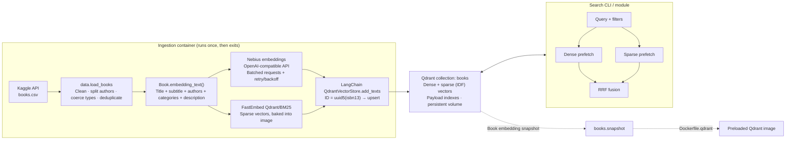

# bookembed

Ingests the [7k Books with Metadata](https://www.kaggle.com/datasets/dylanjcastillo/7k-books-with-metadata)
CSV into a [Qdrant](https://qdrant.tech) collection built for **hybrid search**:

- **Dense + sparse retrieval**: Nebius AI Studio embeddings plus FastEmbed `Qdrant/bm25` sparse
  vectors, fused server-side with Reciprocal Rank Fusion (RRF).
- **Metadata filtering**: every column is stored as payload, with indexes on `authors` and
  `categories` (keyword) and on `published_year`, `num_pages`, `ratings_count` (integer) and
  `average_rating` (float).

`docker compose up` starts Qdrant, downloads and embeds the dataset, upserts ~6.8k books, and
leaves a queryable collection running.

## Quick start

```bash
git clone https://github.com/fsystemweb/bookembed && cd bookembed
cp .env.example .env          # set NEBIUS_API_KEY (Kaggle creds optional, see below)
docker compose up             # ingestion exits 0 when done; Qdrant keeps running
docker compose run --rm ingestion search      # the demo query below
```

Qdrant's dashboard is at <http://localhost:6333/dashboard>.

Want to try it without a Nebius key? Run the keyless fixture stack, which uses fake dense
vectors, real BM25, and the 52-row fixture:

```bash
./scripts/smoke_test.sh
```

## Local development

Requires Python ≥ 3.11 and [uv](https://docs.astral.sh/uv/).

```bash
uv sync                                   # creates .venv from uv.lock
uv run pre-commit install                 # hooks mirror CI
docker run -d -p 6333:6333 qdrant/qdrant:v1.19.2

uv run bookembed download                 # -> data/books.csv
uv run bookembed ingest                   # download if needed, embed, upsert
uv run bookembed ingest --recreate        # drop + rebuild (e.g. after changing model)
uv run bookembed search "cozy mystery in a small village" --min-rating 4
uv run bookembed snapshot                 # -> snapshots/books.snapshot
```

Run the checks the same way CI does:

```bash
uv run ruff check . && uv run ruff format --check . && uv run mypy ingestion
QDRANT_URL=http://localhost:6333 uv run pytest --cov --cov-fail-under=70
./scripts/smoke_test.sh
```

## Environment variables

All configuration goes through `ingestion/config.py` (pydantic-settings). Values come from
the environment or from `.env`. See `.env.example`.

| Variable | Default | Purpose |
|---|---|---|
| `NEBIUS_API_KEY` | — (required when provider is `nebius`) | Nebius AI Studio API key |
| `NEBIUS_EMBEDDING_MODEL` | `Qwen/Qwen3-Embedding-8B` | Any Nebius embedding model, e.g. `BAAI/bge-en-icl` |
| `NEBIUS_BASE_URL` | `https://api.tokenfactory.nebius.com/v1/` | OpenAI-compatible endpoint (`https://api.studio.nebius.com/v1/` also works) |
| `EMBEDDING_PROVIDER` | `nebius` | `fake` = deterministic offline vectors, for tests and smoke runs only |
| `FAKE_EMBEDDING_DIM` | `384` | Vector size of the `fake` provider |
| `EMBEDDING_BATCH_SIZE` | `64` | Texts per embedding request and per Qdrant upsert |
| `EMBEDDING_MAX_RETRIES` | `6` | Retries on 429 / 5xx / timeouts, with jittered exponential backoff |
| `SPARSE_MODEL` | `Qdrant/bm25` | FastEmbed sparse model (keep in sync with the Docker build arg of the same name) |
| `FASTEMBED_CACHE_DIR` | FastEmbed default (`/opt/fastembed` in Docker) | BM25 model cache |
| `KAGGLE_USERNAME`, `KAGGLE_KEY` | unset | Kaggle API credentials. Optional: the dataset is public |
| `KAGGLE_DATASET` | `dylanjcastillo/7k-books-with-metadata` | Dataset slug |
| `KAGGLE_FILE` | `books.csv` | File to extract from the dataset archive |
| `KAGGLE_DOWNLOAD_URL` | `https://www.kaggle.com/api/v1/datasets/download/{dataset}` | Download endpoint template |
| `DOWNLOAD_TIMEOUT` | `120` | Seconds before the dataset download gives up |
| `BOOKS_CSV` | unset | Ingest this local CSV instead of downloading |
| `DATA_DIR` | `data` (`/app/data` in Docker) | Where the downloaded CSV is cached |
| `QDRANT_URL` | `http://localhost:6333` | Compose sets `http://qdrant:6333` |
| `QDRANT_API_KEY` | unset | For Qdrant Cloud or secured instances |
| `QDRANT_COLLECTION` | `books` | Collection name |
| `QDRANT_TIMEOUT` | `60` | Qdrant client request timeout, in seconds |
| `QDRANT_WAIT_SECONDS` | `60` | How long ingestion waits for Qdrant to come up |
| `SNAPSHOT_DIR` | `snapshots` (`/app/snapshots` in Docker) | Default output dir for `bookembed snapshot` |
| `MCP_TRANSPORT` | `stdio` | `bookembed-mcp` transport: `stdio` or `http` (streamable HTTP at `/mcp`) |
| `MCP_HOST` | `127.0.0.1` | Bind address for `http` (the compose `mcp` service uses `0.0.0.0`) |
| `MCP_PORT` | `8000` | Port for `http` |
| `MCP_MAX_LIMIT` | `50` | Upper bound for the `limit` argument of `search_books` |
| `QDRANT_HTTP_PORT`, `QDRANT_GRPC_PORT` | `6333`, `6334` | Host ports published by compose |
| `MCP_HTTP_PORT` | `8000` | Host port published by the optional compose `mcp` service |

## Example searches

```bash
# The demo: "space opera with strong female lead", published after 2000, rating >= 4
docker compose run --rm ingestion search

# Equivalent, spelled out
uv run bookembed search "space opera with strong female lead" --min-year 2001 --min-rating 4

# Keyword filters are exact matches on the stored lists (repeat a flag to OR values)
uv run bookembed search "dragons and political intrigue" --category Fiction --max-pages 400
# The source data spells names inconsistently, so OR the variants you care about
uv run bookembed search "the ring" -k 3 \
  --author "J. R. R. Tolkien" --author "J.R.R. Tolkien" --author "John Ronald Reuel Tolkien"
uv run bookembed search "history of the roman empire" --min-year 1990 --max-year 2010 --json
```

From Python:

```python
from ingestion.config import get_settings
from ingestion.embeddings import build_dense_embeddings, build_sparse_embeddings
from ingestion.search import SearchFilters, hybrid_search
from ingestion.store import connect

s = get_settings()
hits = hybrid_search(
    connect(s),
    s.qdrant_collection,
    "space opera with strong female lead",
    build_dense_embeddings(s),
    build_sparse_embeddings(s),
    filters=SearchFilters(min_year=2001, min_rating=4.0),
    limit=5,
)
for h in hits:
    print(h.score, h.book["title"], h.book["authors"])
```

## MCP server

`bookembed-mcp` exposes the same hybrid search as [MCP](https://modelcontextprotocol.io) tools
(built with FastMCP), so an LLM agent can query the catalogue. It reads the same settings as the
CLI (`QDRANT_*`, `EMBEDDING_PROVIDER`, `NEBIUS_*`) and builds the Qdrant client and embedders on
the first tool call, so it starts even if Qdrant is still down.

| Tool | Arguments | Returns |
|---|---|---|
| `search_books` | `query` (required), `authors[]`, `categories[]`, `min_year`, `max_year`, `min_rating`, `max_pages`, `limit` (1..`MCP_MAX_LIMIT`, default 5) | books ranked by fused score: `score`, `isbn13`, `isbn10`, `title`, `subtitle`, `authors`, `categories`, `published_year`, `average_rating`, `num_pages`, `ratings_count`, `description`, `thumbnail` |
| `get_book` | `isbn13` (13 digits) | one book record, same fields minus `score` |
| `collection_info` | none | `collection`, `exists`, `points_count` |

Filters behave like the CLI flags: exact matches on authors/categories (OR within a list), AND
across filters. A missing collection or unreachable Qdrant comes back as a readable tool error.

```bash
uv run bookembed-mcp                                  # stdio (what desktop clients spawn)
MCP_TRANSPORT=http uv run bookembed-mcp               # http://127.0.0.1:8000/mcp
docker compose --profile mcp up -d mcp                # http://localhost:8000/mcp, next to Qdrant
```

Claude Code:

```bash
# stdio, run from the repo checkout
claude mcp add bookembed -- uv run --directory /path/to/bookembed bookembed-mcp
# or the HTTP service
claude mcp add --transport http bookembed http://localhost:8000/mcp
```

Claude Desktop (`claude_desktop_config.json`); `.env` in the repo is picked up because `uv`
runs from that directory:

```json
{
  "mcpServers": {
    "bookembed": {
      "command": "uv",
      "args": ["run", "--directory", "/path/to/bookembed", "bookembed-mcp"],
      "env": { "QDRANT_URL": "http://localhost:6333" }
    }
  }
}
```

## Architecture



**Collection layout**

| Part | Value |
|---|---|
| Point ID | `uuid5(fixed namespace, isbn13)` |
| `dense` vector | Nebius model output; dimension detected at runtime; cosine distance |
| `sparse` vector | BM25 term frequencies; `modifier: idf`, so Qdrant computes IDF at query time |
| `page_content` payload | the composed text that was embedded |
| `metadata` payload | `isbn13, isbn10, title, subtitle, authors[], categories[], thumbnail, description, published_year, average_rating, num_pages, ratings_count` |
| Payload indexes | `metadata.authors`, `metadata.categories` (keyword); `metadata.published_year`, `metadata.num_pages`, `metadata.ratings_count` (integer); `metadata.average_rating` (float) |

**Repository layout**

```
ingestion/            the package
  config.py           Settings (pydantic-settings)
  download.py         Kaggle download
  data.py             CSV parsing and cleaning -> Book
  embeddings.py       Nebius dense (+ retry wrapper), BM25 sparse, fake provider
  store.py            collection schema and payload indexes
  pipeline.py         orchestration: CSV -> Qdrant
  search.py           hybrid query with filters + RRF
  snapshot.py         snapshot creation and download
  cli.py              `bookembed` entry point
  mcp_server.py       `bookembed-mcp`: FastMCP server with the search tools
tests/                unit tests (offline) + tests/integration (real Qdrant)
tests/fixtures/       52-row sample of books.csv
Dockerfile            ingestion image
Dockerfile.qdrant     Qdrant image pre-loaded from a snapshot
docker-compose.yml    qdrant + ingestion (+ optional `mcp` profile)
docker-compose.smoke.yml  keyless fixture override (CI, qa-validator)
scripts/              smoke_test.sh, build_preloaded_image.sh
.claude/agents/       builder and qa-validator sub-agent definitions
```

## Pre-loaded Qdrant image (skip re-embedding)

After one full `docker compose up`:

```bash
./scripts/build_preloaded_image.sh bookembed-qdrant:preloaded
docker run -p 6333:6333 bookembed-qdrant:preloaded
```

The script calls `bookembed snapshot`, which creates a snapshot server-side and downloads it to
`snapshots/books.snapshot`. It then builds `Dockerfile.qdrant`, which copies the snapshot in and
starts Qdrant with `--snapshot …:books`. Qdrant restores the collection on first boot without
calling the embedding API. To query it with the CLI, use the same `NEBIUS_EMBEDDING_MODEL` that
built it.

## Design decisions

- **LangChain for writes, raw `qdrant-client` for hybrid queries.** `QdrantVectorStore`
  (HYBRID mode) handles embedding and upserts. Its hybrid search caps each prefetch at `k`, which
  leaves RRF with few candidates to re-rank. `search.hybrid_search` issues the same
  `query_points` call with prefetch `max(4k, 20)` and applies the filter both inside each
  prefetch and on the fused result.
- **Nebius through `langchain-openai`.** Nebius exposes an OpenAI-compatible API, and
  `OpenAIEmbeddings` with `check_embedding_ctx_length=False` sends raw strings rather than
  tiktoken IDs, which non-OpenAI models need. This avoids depending on a less widely used
  integration package. The base URL is configurable.
- **Retries live in our own wrapper.** `RetryingEmbeddings` uses tenacity with jittered
  exponential backoff (up to 60 s) on `RateLimitError`, connection and timeout errors, and 5xx.
  The OpenAI client's built-in retries are disabled so backoff is logged and tunable in one place.
  Batches are `EMBEDDING_BATCH_SIZE` texts.
- **Idempotent IDs.** `uuid5(namespace, isbn13)` is stable across runs and machines, so
  re-running `ingest` overwrites points in place. Rows are de-duplicated on ISBN13, and the last
  occurrence wins.
- **Dense dimension is probed, not configured.** One `embed_query` call determines the size. If
  an existing collection has a different size (you changed the model), ingestion refuses to run
  and tells you to pass `--recreate`; mixing dimensions would silently break search.
- **BM25 uses Qdrant's IDF modifier.** FastEmbed's `Qdrant/bm25` emits term frequencies only;
  Qdrant computes IDF over the live collection, so scores stay correct as data changes.
- **Dirty-data policy.** Everything is read as a string first, so ISBNs keep their leading zeros,
  and each field is then coerced individually:
  - Blank values and NaN become `null`.
  - Whitespace is collapsed.
  - `authors` and `categories` are split on `;` and de-duplicated in order.
  - Numbers parse leniently: `"2004.0"` becomes 2004, and junk, `inf`, or NaN become `null`.
  - ISBNs mangled into floats by a spreadsheet are repaired.
  - Rows without an ISBN13 or a title are dropped.
  - A missing description is not fatal: the book is embedded from the fields it does have.
- **Kaggle download over plain HTTPS.** The download sends HTTP basic auth with
  `KAGGLE_USERNAME`/`KAGGLE_KEY`, the same credentials the `kaggle` CLI uses. The heavier
  `kaggle` package is not needed. The dataset is public, so the download also works anonymously
  if no credentials are set.
- **Payload nested under `metadata`.** This is LangChain's convention. Indexes and filters use the
  full path (`metadata.published_year`), and `store.payload_field()` keeps that in one place.
- **A `fake` embedding provider.** CI, unit tests, and the Docker smoke test need a populated
  collection without a Nebius key. Deterministic hash vectors provide one while still exercising
  the real Qdrant schema, BM25, filters, and fusion. Production defaults to `nebius`, and settings
  validation refuses `nebius` without a key.
- **BM25 model baked into the image.** No runtime download from Hugging Face; the container runs
  as non-root.
- **"Published after 2000" means `published_year >= 2001`.**

## Agent workflow

The two Claude Code sub-agents are defined in `.claude/agents/`:

- **builder** (`builder.md`) implements features on a `feat/…` / `fix/…` branch, with tests in the
  same commit, then hands off.
- **qa-validator** (`qa-validator.md`) runs before every PR:
  - ruff check, ruff format check, mypy;
  - the full pytest suite against a real Qdrant, with coverage ≥ 70%;
  - a diff review for secrets, hardcoded config, and missing tests;
  - `scripts/smoke_test.sh`, which runs `docker compose up` on the fixture and asserts the filtered
    demo search returns hits.

  It returns `VERDICT: PASS` or a list of failures. The builder fixes them and the two loop until
  the verdict is PASS. Only then is the PR opened.

`main` is protected: merges go through PRs, and the `lint`, `typecheck`, `test`, and `docker` CI
checks must pass.

## CI

`.github/workflows/ci.yml` runs on every PR and every push to `main`:

| Job | What it runs |
|---|---|
| `lint` | `ruff check`, `ruff format --check` |
| `typecheck` | `mypy ingestion` (strict) |
| `test` | `pytest --cov --cov-fail-under=70`, with integration tests against a Qdrant service container. Nebius is always mocked, and no secrets are needed. |
| `docker` | builds the image, then runs `scripts/smoke_test.sh` (compose up on the fixture, then a search) |
